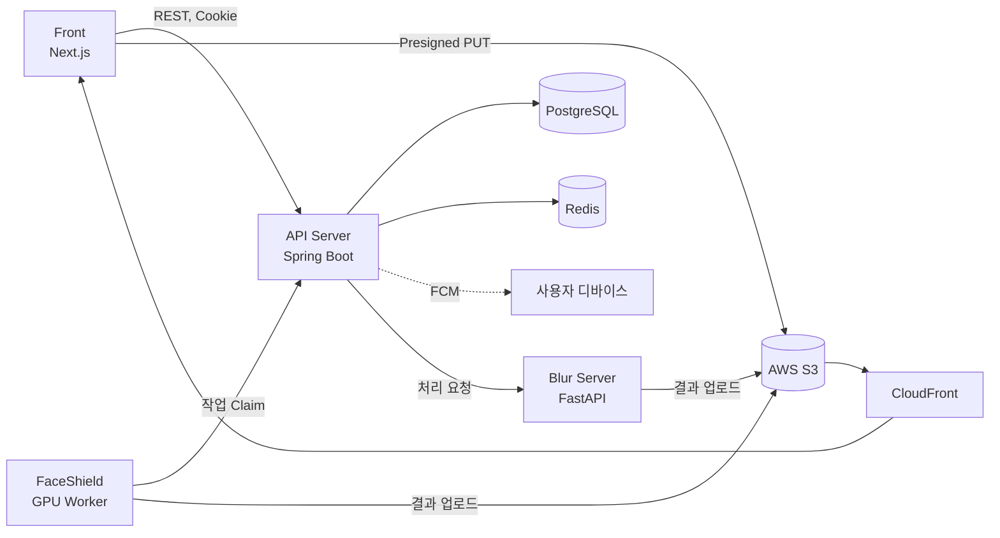

# DeepFence Back

SNS에 사진을 올리기 전에 얼굴에는 딥페이크 방어 노이즈를, 개인정보에는 블러를 입혀 주는 서비스 DeepFence의 **API 서버**입니다.

인증, 이미지 업로드와 상태 관리, AI 처리 서버(Blur, FaceShield) 작업 분배, 푸시 알림 토큰 관리를 담당합니다.

- API: https://api.deepfence.site
- Swagger: https://api.deepfence.site/swagger-ui/index.html
- 서비스 전체 소개: [Codyssey-ROOT](https://github.com/Codyssey-ROOT)

## 기술 스택

| 구분 | 기술 | 용도 |
| --- | --- | --- |
| 언어 | Java 21 | |
| 프레임워크 | Spring Boot 3.5 | Web, Validation, Actuator |
| 인증 | Spring Security, OAuth2 Client, JJWT 0.12 | 카카오 로그인, JWT 발급 및 HttpOnly 쿠키 인증 |
| 데이터 | Spring Data JPA, Querydsl 6 (OpenFeign) | 엔티티 관리, 커서 페이지네이션 및 동적 조회 |
| 데이터베이스 | PostgreSQL 15 | 사용자, 이미지 메타데이터, 처리 작업 저장 |
| 캐시 | Redis 7 | Refresh Token 저장 |
| 스토리지 | AWS S3 (Spring Cloud AWS 3.4), CloudFront | Presigned URL 업로드, 비공개 버킷 + OAC 기반 이미지 제공 |
| 푸시 알림 | Firebase Admin SDK (FCM) | 디바이스 토큰 등록 및 관리 |
| 식별자 | TSID Creator | 시간 순 정렬 가능한 ID 생성 |
| API 문서 | springdoc-openapi (Swagger UI) | |
| 인프라 | Docker, Docker Compose, AWS EC2 | 멀티 스테이지 빌드 이미지 배포 |
| CI/CD | GitHub Actions | `develop`, `main` 푸시 시 Docker Hub 빌드·푸시 후 EC2 배포 |

## 시스템 구성



## 이미지 처리 흐름

1. 클라이언트가 `POST /images/presigned-url`로 업로드 URL을 발급받아 S3에 원본을 직접 업로드합니다.
2. `POST /images/complete` 요청 시 S3 HeadObject로 업로드를 검증하고 상태를 `UPLOADED`로 변경합니다.
3. 트랜잭션 커밋 이후 비동기로 Blur 서버에 처리를 요청하고 상태를 `PROCEED`로 변경합니다.
4. Blur 서버가 `/blur/images/*` 내부 API로 결과 이미지를 업로드하면, FaceShield 작업이 자동으로 등록됩니다.
5. FaceShield GPU 워커가 `/faceshield/jobs/claim`으로 작업을 가져가 처리하고, `/faceshield/images/*`로 결과를 업로드합니다.
6. 처리가 끝난 이미지는 상세 조회에서 원본, 블러, FaceShield 결과를 CloudFront URL로 제공합니다.

이미지 상태는 `UPLOADING → UPLOADED → PROCEED → COMPLETED / FAILED` 순서로 관리하며, FaceShield 작업은 `PENDING → PROCESSING → COMPLETED / FAILED`로 관리합니다. 작업 Claim에는 임대 시간(lease)과 최대 재시도 횟수를 적용하였습니다.

## 주요 API

| 구분 | Method | URI | 설명 |
| --- | --- | --- | --- |
| 사용자 | GET | `/users/me` | 내 정보 조회 |
| 사용자 | DELETE | `/users/me` | 회원 탈퇴 |
| 사용자 | POST | `/users/me/fcm-tokens` | FCM 토큰 등록 |
| 사용자 | POST | `/users/reissue` | 토큰 재발급 |
| 사용자 | POST | `/users/logout` | 로그아웃 |
| 이미지 | POST | `/images/presigned-url` | 업로드 URL 발급 |
| 이미지 | POST | `/images/complete` | 업로드 완료 및 AI 처리 요청 |
| 이미지 | GET | `/images` | 전체 목록 (커서 페이지네이션) |
| 이미지 | GET | `/images/status` | 처리 중, 취약 이미지 목록 |
| 이미지 | GET | `/images/{imageId}` | 원본 및 처리 결과 상세 |
| 내부 | POST | `/blur/images/presigned-url`, `/blur/images/complete` | Blur 서버 결과 업로드 (API Key 인증) |
| 내부 | POST | `/faceshield/jobs/claim`, `/faceshield/jobs/fail` | FaceShield 작업 할당 및 실패 처리 (API Key 인증) |
| 내부 | POST | `/faceshield/images/presigned-url`, `/faceshield/images/complete` | FaceShield 결과 업로드 (API Key 인증) |

내부 API는 사용자 JWT 대신 서버 간 API Key 필터로 인증합니다.

## 패키지 구조

```
src/main/java/site/defence
├── domain
│   ├── image          # 이미지 업로드, 조회, Blur/FaceShield 작업 처리
│   ├── notification   # 알림 엔티티
│   └── user           # 회원, 인증, FCM 토큰
└── global
    ├── config         # Security, 비동기 실행, 외부 연동 설정
    ├── security       # JWT, OAuth2 핸들러, 내부 API Key 필터
    ├── storage        # S3 Presigned URL, CloudFront URL
    ├── exception      # 공통 예외
    ├── handler        # 전역 예외 처리
    ├── response       # 공통 응답 포맷
    └── ...            # constant, entity, util, validator
```

각 도메인은 `controller / service / repository / entity / dto / exception`으로 구성하고, Querydsl 조회는 `XxxQueryRepository`로 분리하였습니다.

## 실행 방법

### 사전 준비

- Java 21
- Docker, Docker Compose

### 환경 변수

프로젝트 루트에 `.env` 파일을 작성합니다. 비밀 값은 저장소에 커밋하지 않습니다.

| 구분 | 변수 |
| --- | --- |
| 데이터베이스 | `POSTGRES_DB`, `POSTGRES_USER`, `POSTGRES_PASSWORD`, `POSTGRES_PORT` |
| JWT | `JWT_SECRET`, `JWT_ACCESS_TOKEN_EXPIRE`, `JWT_REFRESH_TOKEN_EXPIRE` |
| 카카오 로그인 | `KAKAO_CLIENT_ID`, `KAKAO_CLIENT_SECRET`, `OAUTH2_SUCCESS_REDIRECT_URL` |
| AWS | `AWS_REGION`, `AWS_S3_BUCKET`, `CDN_BASE_URL`, `IMAGE_MAX_FILE_SIZE`, `IMAGE_PRESIGNED_PUT_TTL` |
| 서비스 주소 | `DOMAIN`, `APP_BASE_URL`, `CLIENT_BASE_URL` |
| AI 서버 연동 | `BLUR_BASE_URL`, `BLUR_API_KEY`, `INTERNAL_API_KEY`, `FACESHIELD_INTERNAL_API_KEY`, `FACESHIELD_LEASE_SECONDS`, `FACESHIELD_MAX_ATTEMPTS` |
| Firebase | `FIREBASE_ENABLED`, `FIREBASE_SERVICE_ACCOUNT_BASE64` |

### 실행

```bash
# PostgreSQL, Redis, API 서버 실행
docker compose up -d --build
```

서버는 `http://localhost:8080`에서 실행되며, Swagger는 `http://localhost:8080/swagger-ui/index.html`에서 확인할 수 있습니다.

## 배포

`develop`, `main` 브랜치에 푸시하면 GitHub Actions가 다음을 수행합니다.

1. Docker 이미지를 빌드하여 Docker Hub에 푸시
2. `docker-compose.prod.yml`을 EC2에 복사
3. EC2에서 새 이미지를 받아 컨테이너 재시작

## 외부 자원 활용 내역

| 구분 | 명칭 | 용도 | 라이선스 |
| --- | --- | --- | --- |
| 오픈소스 | Spring Boot, Spring Security, Spring Data JPA | 서버 프레임워크 | Apache 2.0 |
| 오픈소스 | Spring Cloud AWS | S3 연동 | Apache 2.0 |
| 오픈소스 | Querydsl (OpenFeign) | 동적 쿼리 | Apache 2.0 |
| 오픈소스 | JJWT | JWT 발급 및 검증 | Apache 2.0 |
| 오픈소스 | springdoc-openapi | API 문서 | Apache 2.0 |
| 오픈소스 | TSID Creator | ID 생성 | MIT |
| 오픈소스 | Lombok | 보일러플레이트 코드 생성 | MIT |
| 오픈소스 | PostgreSQL, Redis | 데이터베이스, 캐시 | PostgreSQL License / BSD 계열 |
| 외부 API | 카카오 로그인 (OAuth 2.0) | 소셜 로그인 | 카카오 개발자 약관 |
| 외부 API | Firebase Cloud Messaging | 푸시 알림 | Google 서비스 약관 |
| 외부 서비스 | AWS S3, CloudFront, EC2 | 이미지 저장 및 배포, 서버 운영 | 상용 |
